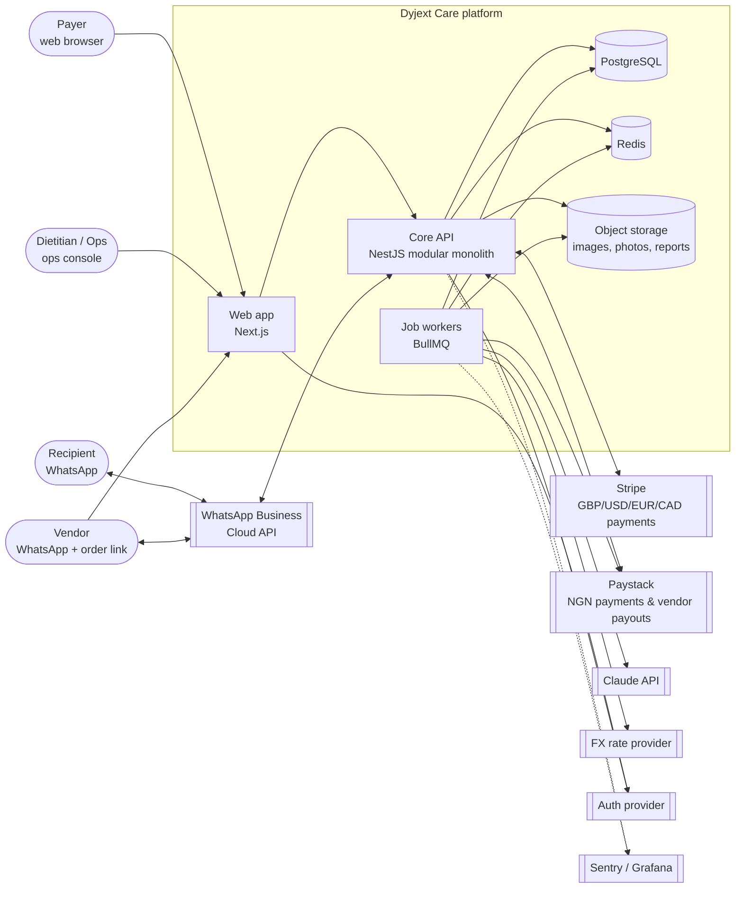
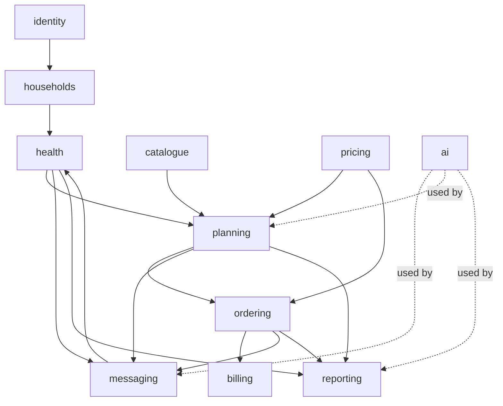
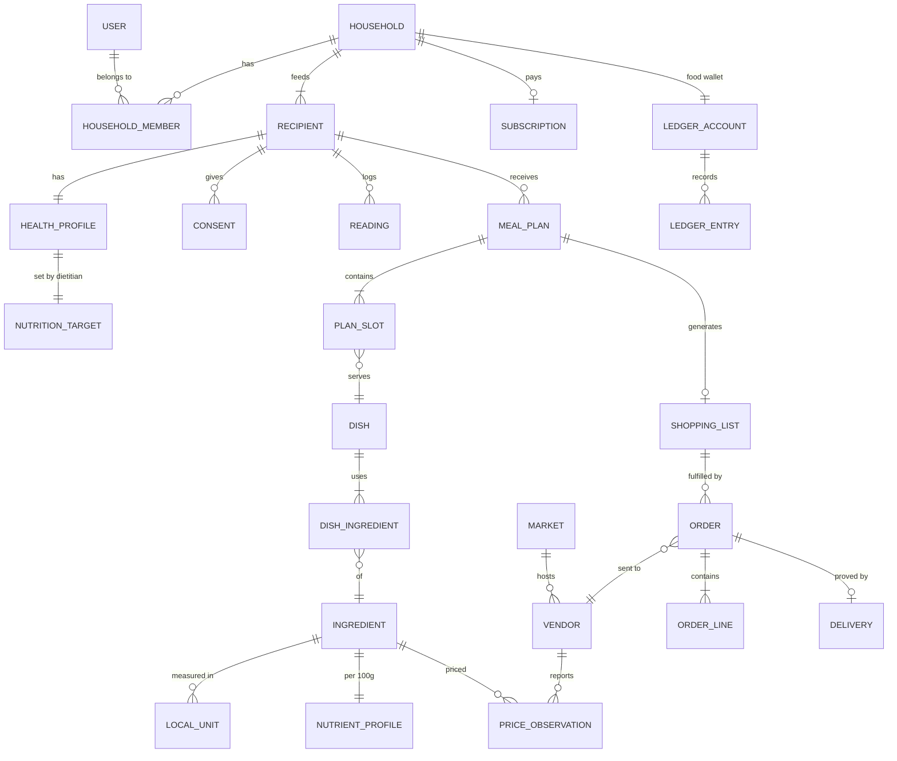
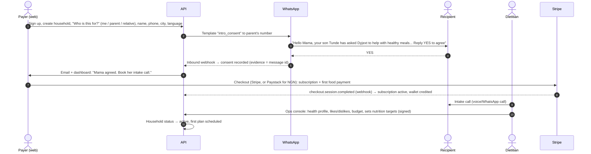
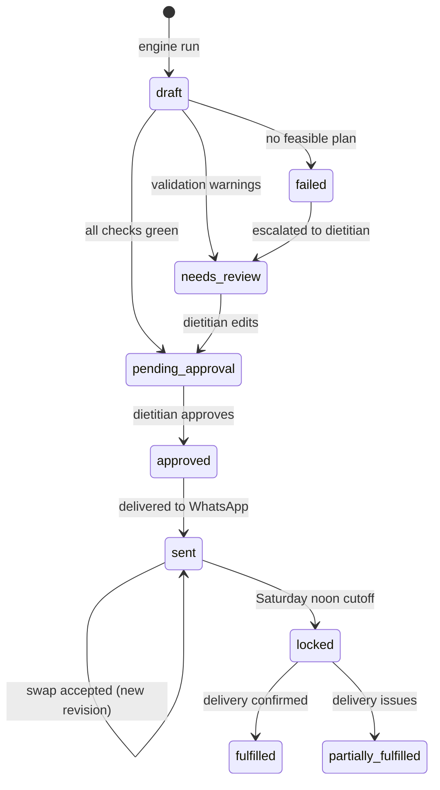
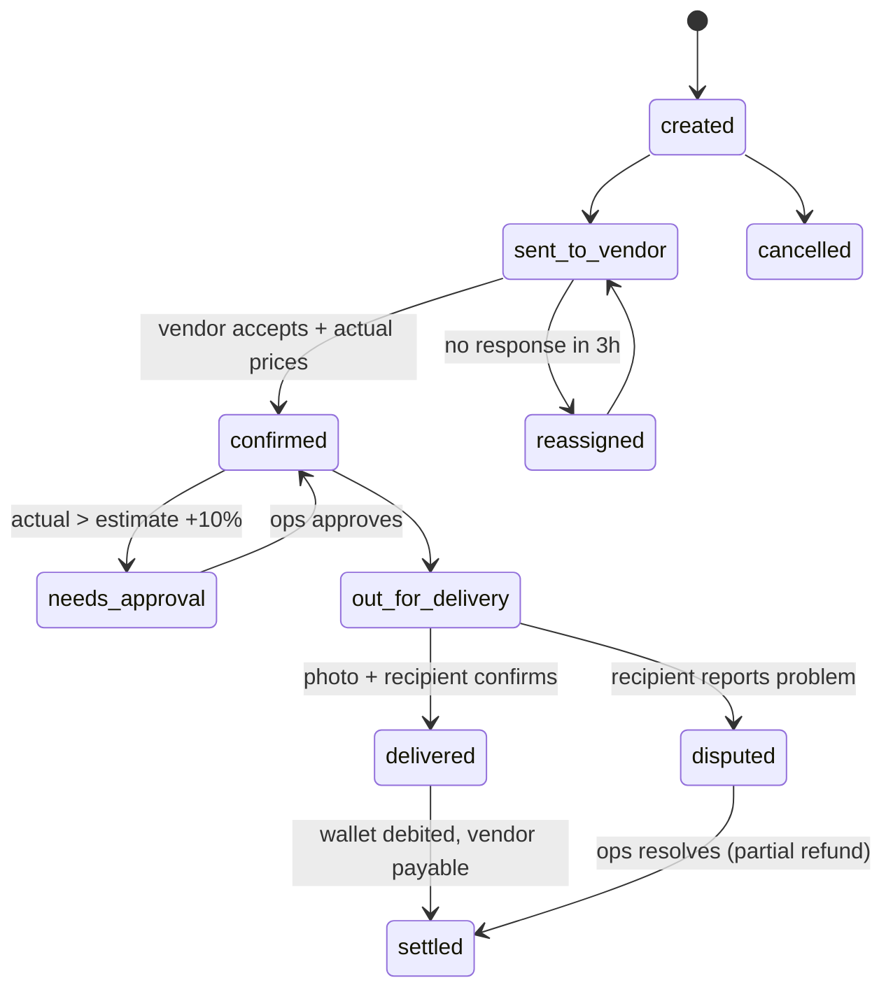

# Dyjext Care — System Architecture

> **Status:** Draft v1 (pre-build). This document is the source of truth for what we build first.
> It replaces the earlier "AI meal planner for six cuisines" design in `README.md`.

---

## 1. Product in one paragraph

A **Payer**, living anywhere (London, Houston or Lagos), subscribes so that a **Recipient** living
with diabetes or hypertension eats healthy, familiar food every week. The Recipient is often a
parent, but can be another relative, or the Payer themself. Each week the system builds a
condition-aware meal plan from a verified catalogue of local dishes, a **dietitian** approves it,
and it is sent to the Recipient on **WhatsApp**. In delivery areas (**full care**), a local
**Vendor** buys and delivers the ingredients and the Payer gets a delivery photo; elsewhere
(**plan only**), the Recipient gets a shopping list and buys their own food. The Payer also gets a
monthly progress report. Money is collected in the Payer's currency (NGN, GBP, USD, EUR, CAD) and
paid out to vendors locally in NGN (later GHS, KES, ZAR). See ADR 010.

### Actors

| Actor                                      | Channel                                   | What they do                                                                   |
| ------------------------------------------ | ----------------------------------------- | ------------------------------------------------------------------------------ |
| **Payer** (anywhere; may be the Recipient) | Web app (desktop + mobile)                | Signs up, adds a parent, relative or themself, pays, reads reports             |
| **Recipient** (parent, relative or self)   | WhatsApp (plus the web app if self)       | Gives consent, receives plan, asks for swaps, answers check-ins, logs readings |
| **Dietitian** (staff/contractor)           | Ops console                               | Runs intake, sets nutrition targets, approves plans, handles escalations       |
| **Ops agent** (staff)                      | Ops console                               | Manages vendors, prices, orders, deliveries, support                           |
| **Vendor** (market runner / grocer)        | WhatsApp + one-page order link (no login) | Confirms order, enters actual prices, uploads delivery photo                   |
| **Admin**                                  | Ops console                               | Catalogue, users, finance, configuration                                       |

### MVP scope (Phase 1)

- **One city:** Lagos. **One cuisine:** Nigerian. **Two conditions:** type 2 diabetes, hypertension.
- **Payer currencies:** NGN and GBP first, USD second. Payers can live anywhere.
- **Service tiers:** full care (with delivery) in Lagos; plan only (shopping list, no delivery) anywhere.
- ~100 verified dishes, 1–3 vendors, 1–2 dietitians, target 50–200 households.

Everything below is designed so a second city/cuisine/currency is **configuration + data**, not new code.

---

## 2. Architecture principles

1. **Modular monolith first.** One deployable backend with strict internal module boundaries.
   Split into services only when a module has a different scaling or team need.
2. **Rules decide, AI writes.** Medical and nutritional limits are enforced by deterministic code
   reviewed by a dietitian. The LLM only drafts human-friendly text and suggests options that the
   rules engine re-validates.
3. **Data is the moat.** The food catalogue (dishes, local units, nutrition, prices) is a
   first-class, versioned, audited asset.
4. **Money is a ledger, not a column.** Every financial movement is a double-entry ledger record,
   in minor units, with the FX rate stored.
5. **The parent never installs anything.** All Recipient and Vendor interaction works over WhatsApp
   and plain links.
6. **Health data is sensitive by default.** Encrypt, minimise, audit, and get the Recipient's own
   consent — not just the Payer's.
7. **Everything asynchronous is a job.** Plan generation, messaging, ordering, reports run on a
   queue with retries and idempotency.
8. **Boring, managed infrastructure.** No Kubernetes, no self-hosted models until scale demands it.

---

## 3. System context



---

## 4. Technology choices

| Concern                    | Choice                                                                                                          | Why                                                                                     | Rejected alternatives                                                           |
| -------------------------- | --------------------------------------------------------------------------------------------------------------- | --------------------------------------------------------------------------------------- | ------------------------------------------------------------------------------- |
| Language                   | **TypeScript** everywhere                                                                                       | One language for web, API, workers, shared types; existing code is TS                   | Python backend (two stacks for a tiny team)                                     |
| Monorepo                   | **pnpm workspaces + Turborepo**                                                                                 | Shared packages (types, schemas, planner) with cached builds                            | Separate repos (version drift)                                                  |
| Backend framework          | **NestJS** (on Fastify adapter)                                                                                 | Modules, DI, guards, OpenAPI generation — enforces the module boundaries in §6          | Plain Express (structure must be hand-built — the current code shows the drift) |
| ORM / migrations           | **Prisma**                                                                                                      | Schema-first, reliable migrations, typed client                                         | TypeORM (current code is already broken by the 0.2→0.3 API change)              |
| Validation                 | **zod** schemas in `packages/shared`, shared by web + API                                                       | One definition for request validation and form validation                               | class-validator only on server                                                  |
| Database                   | **PostgreSQL 16** (managed)                                                                                     | Relational core + JSONB for plan snapshots; row-level locks for ledger                  | —                                                                               |
| Queue / cache              | **Redis + BullMQ**                                                                                              | Scheduled & retryable jobs, rate limiting, idempotency keys                             | Cron-only (no retries/visibility)                                               |
| Web app                    | **Next.js (App Router) + Tailwind + shadcn/ui**                                                                 | Marketing pages (SEO) + Payer app + Ops console in one app with role-based route groups | CRA (deprecated; current `frontend/` is the untouched CRA template)             |
| Auth                       | **Managed provider** (Clerk or Auth0) issuing JWTs; API verifies                                                | Passwordless/social login, MFA for staff, no password storage liability                 | Hand-rolled auth                                                                |
| Recipient / Vendor channel | **WhatsApp Business Platform (Cloud API)** via Meta directly                                                    | Where parents and vendors already are                                                   | Native mobile app (parents won't install), SMS (no rich media, poor UX)         |
| Payer payments             | **Stripe Billing + Checkout** (GBP/USD/EUR/CAD) and **Paystack** (NGN), behind one `PaymentGateway` interface   | Stripe: cards, Apple/Google Pay, dunning. Paystack: Nigerian cards, bank transfer, USSD | One provider for all (Nigerian cards often fail on foreign processors)          |
| Local payouts              | **Paystack Transfers** (NGN). Flutterwave as fallback; M-Pesa B2C for Kenya later                               | Reliable NGN bank payouts with webhooks                                                 | Manual bank transfers (no audit trail)                                          |
| AI                         | **Claude API** via `@anthropic-ai/sdk` (see §11)                                                                | Message drafting, swap suggestions, report narratives                                   | Self-hosted LLaMA (GPU cost/ops with no benefit at this scale)                  |
| Object storage             | **S3-compatible** (AWS S3 or Cloudflare R2)                                                                     | Dish images, delivery photos, PDF reports                                               | —                                                                               |
| Hosting (Phase 1)          | **Managed PaaS** (e.g. Render) in an EU/UK region: web, api, worker services + managed Postgres + managed Redis | Lowest ops burden for a 1–3 person team                                                 | Kubernetes (premature)                                                          |
| Hosting (Phase 3+)         | **AWS eu-west-2**: ECS Fargate, RDS, ElastiCache, S3, CloudFront via Terraform                                  | When volume, compliance or cost justifies it                                            | —                                                                               |
| Observability              | **Sentry** (errors), **OpenTelemetry → Grafana Cloud** (traces/metrics), **pino** JSON logs                     | Cheap, standard                                                                         | Self-hosted Prometheus (ops burden)                                             |
| CI/CD                      | **GitHub Actions**                                                                                              | Already on GitHub                                                                       | —                                                                               |
| Email                      | Transactional provider (e.g. Postmark/Resend)                                                                   | Receipts, reports to Payer                                                              | —                                                                               |

---

## 5. Repository layout (target)

```
.
├── apps/
│   ├── web/                 # Next.js: marketing, /app (Payer), /ops (staff), /v (vendor order links)
│   ├── api/                 # NestJS HTTP API + webhooks
│   └── worker/              # BullMQ workers + schedulers (same codebase modules, different entrypoint)
├── packages/
│   ├── db/                  # Prisma schema, migrations, seed scripts, catalogue importers
│   ├── shared/              # zod schemas, DTO types, enums, money/units helpers
│   ├── planner/             # Pure TS meal-planning engine (no I/O) — heavily unit-tested
│   ├── nutrition/           # Nutrient maths, unit conversion (derica/mudu/cup → grams)
│   ├── messaging/           # WhatsApp template registry + message builders
│   └── config/              # eslint, tsconfig, prettier presets
├── infra/                   # Terraform (Phase 3), render.yaml (Phase 1), docker-compose for local
├── docs/
│   ├── ARCHITECTURE.md      # this file
│   └── adr/                 # one file per architecture decision
├── .github/workflows/
└── README.md
```

**Migration from today's repo:** the current `backend/` entities (User, Dish, NutritionFacts,
RecipeGuide, MealPlan) and `nutrientCalculator.ts` are ported into `packages/db` (Prisma models)
and `packages/nutrition`. The CRA `frontend/` is deleted and replaced by `apps/web`. The
`llm-service` described in the old README is not built.

---

## 6. Backend modules (bounded contexts)

Each module owns its tables and exposes a service interface; other modules never query its
tables directly. Cross-module side effects go through **domain events** (in-process event bus,
persisted to an `outbox` table so workers can react reliably).

| #   | Module         | Owns                                                                                  | Key responsibilities                                                                                        |
| --- | -------------- | ------------------------------------------------------------------------------------- | ----------------------------------------------------------------------------------------------------------- |
| 1   | **identity**   | users, staff_roles                                                                    | Map auth-provider identities to Payers/staff; RBAC (`payer`, `dietitian`, `ops`, `admin`)                   |
| 2   | **households** | households, recipients, consents, addresses                                           | Payer ↔ Recipient link, Recipient phone verification and consent capture, delivery address                  |
| 3   | **health**     | health_profiles, nutrition_targets, readings, escalations                             | Conditions, allergies, chewing/cooking ability, dietitian-set targets, glucose/BP logs, alerting thresholds |
| 4   | **catalogue**  | ingredients, local_units, dishes, dish_ingredients, recipes, nutrition_profiles, tags | The food database; versioned; dietitian verification status per dish                                        |
| 5   | **pricing**    | markets, vendors, vendor_catalogue, price_observations, fx_rates                      | Current ingredient prices per market, FX snapshots, basket cost estimation                                  |
| 6   | **planning**   | meal_plans, plan_days, plan_slots, swap_requests                                      | Runs the planner engine, plan lifecycle, dietitian review, swaps                                            |
| 7   | **ordering**   | shopping_lists, orders, order_lines, deliveries                                       | Plan → shopping list → vendor order → confirmation → delivery proof                                         |
| 8   | **billing**    | subscriptions, ledger_accounts, ledger_entries, payouts, invoices                     | Stripe subscriptions, food wallet, double-entry ledger, vendor payouts, FX margin                           |
| 9   | **messaging**  | conversations, messages, templates, check_ins                                         | WhatsApp send/receive, template management, inbound intent routing, 24-hour window tracking                 |
| 10  | **reporting**  | reports                                                                               | Weekly delivery summaries + monthly Payer reports (data + LLM narrative + PDF)                              |
| 11  | **ai**         | ai_requests (audit)                                                                   | Single gateway to Claude: prompts, structured outputs, cost tracking, safety checks                         |
| 12  | **audit**      | audit_log                                                                             | Immutable record of who viewed/changed health data, plans, money                                            |



---

## 7. Data model

### 7.1 Conventions

- Primary keys: **UUIDv7** (sortable, safe to expose).
- Money: `amount_minor BIGINT` + `currency CHAR(3)`. Never floats.
- Quantities: grams (`qty_g NUMERIC(10,2)`) internally; local units only at the edges.
- Every table: `created_at`, `updated_at`; soft delete (`deleted_at`) only where legally needed.
- Health fields marked 🔒 are encrypted at the application layer (envelope encryption, KMS key).
- snake_case in the database via Prisma `@map` — one naming convention, enforced by lint.

### 7.2 Core entities



### 7.3 Table notes (fields that matter)

**households / recipients**

- `recipients`: `display_name`, `phone_e164` (unique), `phone_verified_at`, `language` (`en`, `pcm` Nigerian Pidgin, `yo`, `ig`, `ha`), `market_id`, `address_id`, `relationship` (`self`, `parent`, `relative`, `other`), `user_id` (set when the Recipient is the Payer), `service_tier` (`full_care`, `plan_only`), `status` (`invited` → `consented` → `active` → `paused` → `closed`).
- `consents`: `recipient_id`, `type` (`health_data_processing`, `whatsapp_messaging`, `share_with_payer`), `granted_at`, `method` (`whatsapp_reply`, `dietitian_call`), `evidence_message_id`, `revoked_at`.

**health**

- `health_profiles` 🔒: `conditions[]` (`t2_diabetes`, `hypertension`, `ckd` — CKD is _out of scope_ in MVP and blocks onboarding), `medications_text`, `allergies[]`, `intolerances[]`, `religious_rules[]`, `chewing_difficulty`, `can_cook` (`self`, `helper`, `no`), `household_size_eating`.
- `nutrition_targets`: per-meal and per-day `kcal`, `carbs_g` min/max, `protein_g` min, `sodium_mg` max, `fiber_g` min, `added_sugar_g` max; `set_by_staff_id`, `valid_from`. **The planner only uses targets that a dietitian has signed.**
- `readings` 🔒: `type` (`fasting_glucose`, `post_meal_glucose`, `bp`), values, `unit`, `taken_at`, `source` (`whatsapp`, `staff`).
- `escalations`: `reason` (`reading_out_of_range`, `reported_symptom`, `missed_deliveries`, `no_response_7d`), `severity`, `assigned_to`, `resolved_at`.

**catalogue** (the moat)

- `ingredients`: `name`, `aliases[]` (local names in en/yo/ig/ha/pcm), `category` (`staple`, `protein`, `vegetable`, `oil`, `seasoning`, …), `is_pantry_staple` (bought monthly, not weekly), `perishability_days`.
- `nutrient_profiles`: per 100 g edible portion; `source` (`FAO/INFOODS WAFCT 2019`, `lab`, `label`, `estimate`), `confidence`.
- `local_units`: `ingredient_id` (nullable for generic units), `name` (`derica`, `mudu`, `paint_bucket`, `wrap`, `ladle`, `cooking_spoon`, `piece`, `bunch`, `tuber`), `grams` (median), `grams_p10`, `grams_p90`, `market_id` (units vary by market).
- `dishes`: `name`, `aliases[]`, `cuisine`, `meal_types[]`, `dish_type` (`soup`, `swallow`, `main`, `side`, `snack`, `drink`), `pairs_with_dish_type[]` (e.g. soup ↔ swallow), `prep_min`, `cook_min`, `batch_cookable` (soups/stews cooked once for several days), `keeps_days`, `texture` (`soft` for chewing difficulty), `verification_status` (`draft` → `dietitian_verified`), `version`.
- `dish_ingredients`: `qty_g` per serving, `optional`, `substitutes[]`.
- `recipes`: steps (markdown), `difficulty`, `equipment`, `language`, short audio/voice-note URL (later).

**pricing**

- `markets`: `city`, `name` (e.g. Mile 12, Oyingbo), `currency`.
- `vendors`: `market_id`, `whatsapp_phone`, `payout_account_ref` (Paystack recipient code), `rating`, `status`.
- `price_observations`: `ingredient_id`, `local_unit_id`, `price_minor`, `currency`, `observed_at`, `source` (`vendor_quote`, `order_actual`, `ops_survey`). The **current price** = robust median of the last N observations per market.
- `fx_rates`: `base`, `quote`, `rate`, `provider`, `fetched_at`. Snapshotted, never overwritten.

**planning**

- `meal_plans`: `recipient_id`, `week_start`, `status` (see §8.2), `engine_version`, `inputs_snapshot` JSONB (targets, prices, preferences used — for reproducibility), `score`, `explanation` JSONB, `approved_by`, `approved_at`, `est_basket_minor`.
- `plan_slots`: `day`, `meal_type`, `dish_id`, `dish_version`, `servings`, `portion_display` (e.g. "1 fist-size wrap of eba + 1 ladle of efo riro"), computed nutrients.
- `swap_requests`: `slot_id`, `requested_via`, `free_text`, `proposed_dish_id`, `status`.

**ordering**

- `shopping_lists`: `plan_id`, lines `{ingredient_id, qty_g_needed, buy_unit_id, buy_qty, est_price_minor}`.
- `orders`: `vendor_id`, `status` (see §8.3), `est_total_minor`, `actual_total_minor`, `currency`, `service_fee_minor`, `vendor_token` (for the no-login order link), `due_at`.
- `deliveries`: `delivered_at`, `photo_urls[]`, `recipient_confirmed` (WhatsApp reply), `issues`.

**billing** (see §10)

- `subscriptions`: `provider` (`stripe`, `paystack`), `provider_subscription_id`, `plan_code`, `service_tier`, `currency`, `status`, `current_period_end`.
- `prices`: `plan_code`, `service_tier`, `currency`, `amount_minor`: set per currency, never converted from another currency.
- `ledger_accounts`, `ledger_entries`, `payouts`, `fx_conversions`, `webhook_events` (idempotency).

---

## 8. Core workflows

### 8.1 Onboarding



Rules:

- No health data is stored until the Recipient's own consent is recorded. This applies to self-subscribers too; their WhatsApp reply also proves the number is theirs.
- The service tier follows the Recipient's location: full care in delivery areas, plan only elsewhere (no vendor, no food charges).
- If the Recipient says no or doesn't respond within 7 days, the Payer is told and nothing further is sent.
- Out-of-scope conditions (e.g. kidney disease, insulin-dependent pregnancy) → dietitian refers out; no plan generated.

### 8.2 Weekly cycle (the heartbeat)

All times in the Recipient's market timezone (`Africa/Lagos`). Default cadence, configurable per market:

| When            | Job                                       | Result                                                                        |
| --------------- | ----------------------------------------- | ----------------------------------------------------------------------------- |
| Wed 10:00       | `pricing.refresh`                         | Vendors' price quotes requested via WhatsApp; FX snapshot taken               |
| Thu 09:00       | `planning.generateDrafts`                 | Draft plan per active recipient; budget and nutrition validated               |
| Thu 09:00–18:00 | Dietitian review queue                    | Approve / edit / regenerate (bulk-approve when all checks green)              |
| Fri 10:00       | `messaging.sendPlan`                      | Plan sent to Recipient (WhatsApp list message + optional PDF/image)           |
| Fri–Sat 12:00   | Swap window                               | Recipient replies e.g. "no okra this week" → swap engine (§9.5)               |
| Sat 12:00       | `planning.lock` → `ordering.createOrders` | Plan locked, shopping list built, order sent to vendor, wallet funds reserved |
| Sat 18:00       | Vendor confirms with actual prices        | Reservation adjusted to actual; over-budget >10% needs ops approval           |
| Sun             | Delivery                                  | Vendor uploads photo via order link; Recipient asked "Did you receive?"       |
| Sun 20:00       | `billing.settleOrder`                     | Wallet debited, vendor payable created; Payer notified with photo             |
| Mon 10:00       | `billing.payouts`                         | Batch NGN payouts to vendors                                                  |
| Wed 18:00       | `messaging.checkIn`                       | Mid-week check-in: meals eaten? reading? any problem?                         |

**Plan status machine**



### 8.3 Order status machine



### 8.4 Check-ins and escalation

1. Mid-week template: _"How are you this week? 1) Ate the meals 2) Ate some 3) Didn't eat. You can also send your sugar or BP reading."_
2. Inbound text is parsed: first by **deterministic patterns** (numbers like `7.2`, `130/85`, menu choices), then by the **AI gateway** for free text (structured output: intent, reading values, sentiment, symptom flags).
3. Readings outside dietitian-set thresholds, or any **red-flag symptom** keyword (chest pain, fainting, confusion, very high/low sugar) → immediate templated reply advising to contact a doctor / emergency services, plus an `escalation` to the dietitian **and** notification to the Payer.
4. **The system never gives medical or medication advice.** All automated replies about health come from pre-approved templates.

### 8.5 Monthly report (to Payer)

- Data: deliveries made, % meals reported eaten, readings trend chart, wallet spend, dietitian notes.
- Narrative paragraph drafted by AI from the structured data (§11), reviewed by the dietitian before sending in Phase 1, auto-sent with sampling review later.
- Delivered as email + PDF + dashboard page.

---

## 9. The planning engine (`packages/planner`)

A pure function. No database, no network. Same inputs + same seed → same plan. This makes it
testable, explainable to dietitians, and reproducible for audits.

```ts
generatePlan(input: PlannerInput, opts: { seed: string; engineVersion: string }): PlannerResult
```

### 9.1 Inputs

- **Targets** (dietitian-signed): per-meal and per-day bands for kcal, carbs, protein, sodium, fibre, added sugar.
- **Hard exclusions:** allergies, intolerances, religious rules, disliked dishes/ingredients, texture needs.
- **Candidate dishes:** only `dietitian_verified` dishes, with nutrients per serving.
- **Availability** (plan only, outside Nigeria): where each ingredient can be bought in the Recipient's country (`supermarket`, `african_shop`, `online`, `not_available`), and dietitian-approved substitutes. See ADR 010.
- **Prices:** current price per ingredient per market + FX rate.
- **Budget:** weekly food budget (Payer setting) in local currency.
- **Context:** meal slots per day (e.g. breakfast, lunch, dinner, 1 snack), cooking ability, batch-cooking preference, household size eating the same food, last 4 weeks of plans (for variety), seasonal availability.

### 9.2 Algorithm

1. **Filter** — drop any dish that violates a hard exclusion or whose _minimum_ portion already exceeds a per-meal limit. Abroad, also drop any dish with a required ingredient the Recipient can't buy (directly or through an approved substitute); substitutes replace the original before nutrients are computed.
2. **Portioning** — for each remaining (dish, slot) pair, compute the portion multiplier (within allowed bounds, e.g. 0.5×–1.5×, snapped to sensible local units) that best fits the slot's targets. Low-carb pairing logic: e.g. a soup is paired with a smaller swallow portion, or with a lower-GI swallow, to hit the carb band.
3. **Construct** — greedy assignment of slots ordered by most-constrained first, honouring pairings (soup ↔ swallow) and batch-cook groups (one pot of soup covers 2–3 days).
4. **Improve** — local search (swap / replace moves, simulated annealing, fixed iteration budget) maximising the score below while all hard constraints hold.
5. **Validate** — independent checker recomputes nutrients and budget from scratch; any violation → plan is `failed` or `needs_review`, never silently sent.
6. **Explain** — per-day nutrient totals vs targets, why each dish was chosen, and which constraints were binding.

### 9.3 Constraints and score

| Type     | Rule                                                                            |
| -------- | ------------------------------------------------------------------------------- |
| Hard     | Every slot's carbs, sodium within dietitian bands; daily totals within bands    |
| Hard     | No excluded ingredient/dish; texture rule respected                             |
| Hard     | Estimated basket cost ≤ weekly budget                                           |
| Hard     | Same dish ≤ N times/week (default 2, batch-cooked soups count as one cook)      |
| Soft (+) | Recipient's favourite dishes; dishes rated well in check-ins                    |
| Soft (+) | Ingredient reuse across the week (less waste, cheaper basket)                   |
| Soft (+) | Fibre and protein above minimums; vegetable variety                             |
| Soft (−) | Repeating last week's dishes; long cook times if `can_cook = self` and age high |

Score weights live in config (`planner_weights` table, versioned) so dietitians can tune without a deploy.

### 9.4 Shopping list derivation

1. Sum `qty_g` per ingredient across all slots × servings × household eaters.
2. Subtract pantry staples (oil, salt, seasoning cubes) — these go on a **monthly** list.
3. Convert grams → **purchasable local units** (round up to nearest derica/mudu/bunch/piece), using the market's `local_units` table.
4. Price with current price observations; produce `est_total` with a ±range from the unit and price variance.
5. Abroad (plan only): use the substitute's name, group the list by where to buy (supermarket, African or Caribbean shop, online), and use metric or local retail units instead of market units; no prices.

### 9.5 Swaps

Recipient: _"I don't want beans this week."_ → AI gateway extracts `{action: "remove", target: "beans"}` →
planner proposes up to 3 alternatives that keep all hard constraints → Recipient picks with a
WhatsApp reply button → plan revision saved. If no valid alternative exists, the request goes to
the dietitian queue.

### 9.6 Upgrade path

If the heuristic struggles (more conditions, larger catalogue), replace step 3–4 with an
integer-programming solver (e.g. OR-Tools CP-SAT in a small Python sidecar) behind the same
`generatePlan` interface. Not needed for MVP.

---

## 10. Money: subscriptions, food wallet, ledger, FX

### 10.1 Revenue streams

1. **Care subscription** (monthly, in the Payer's currency, through Stripe or Paystack; full care or plan only).
2. **Service fee on groceries** (% of basket, shown transparently).
3. **FX spread** (small, disclosed margin between mid-market rate and applied rate).
4. **Add-ons**: extra dietitian consultations, cooked-meal deliveries (Phase 2).

### 10.2 Food wallet

The Payer pre-funds a wallet in their currency (manual top-up or auto top-up below a threshold).
Weekly orders **reserve** funds when the plan locks and **capture** the actual amount on delivery.
The wallet is never allowed to go negative; if insufficient, the plan is produced but the order
is paused and the Payer is prompted.

> Legal note: holding customer funds can count as e-money / payment services in the UK/EU. Mitigation
> to validate with counsel before launch: structure top-ups as **prepayment for specific goods
> and services** with clear terms and refunds, or charge the actual basket weekly via Stripe
> (saved card, off-session) instead of a stored balance. The ledger design below supports both.

### 10.3 Double-entry ledger

Accounts (per currency):

- `payer_wallet:{household}` (liability), `vendor_payable:{vendor}` (liability),
- `revenue:subscription`, `revenue:service_fee`, `revenue:fx_spread`,
- `cash:stripe_gbp`, `cash:paystack_ngn`, `fx_clearing`.

Every business event writes a **balanced transaction** (sum of debits = sum of credits per
currency). Entries are immutable; corrections are reversing entries.

Example — order settled: basket ₦45,000, service fee 12%, FX 1 GBP = ₦2,000 mid, applied ₦1,960:

```
payer_wallet:H1        DR  £25.71   (₦50,400 ÷ 1,960)
fx_clearing            CR  £25.71
fx_clearing            DR  ₦50,400
vendor_payable:V1      CR  ₦45,000
revenue:service_fee    CR  ₦5,400
(fx spread recognised when GBP is actually converted at settlement)
```

_Figures illustrative._

### 10.4 Rules

- All Stripe / Paystack / WhatsApp webhooks are verified (signatures), stored in `webhook_events`, and processed **idempotently** by event id.
- Every outbound money call carries an idempotency key derived from the ledger transaction id.
- Daily reconciliation job: Stripe balance transactions and Paystack transfers vs ledger; mismatches raise an ops alert.
- Prices quoted to the Payer in their currency are **locked at plan-lock time** using the snapshot FX rate.
- When the Payer's currency is the food currency (e.g. an NGN Payer with a Lagos Recipient), no FX rate or FX margin applies.

---

## 11. AI gateway (`ai` module)

All LLM calls go through one service so prompts, models, costs and safety rules are controlled in one place.

### 11.1 Uses

| Use                             | Input                                           | Output (structured)                                            | Human in loop                                |
| ------------------------------- | ----------------------------------------------- | -------------------------------------------------------------- | -------------------------------------------- |
| Draft plan message to Recipient | Approved plan, language, name                   | `{ text, list_items[] }` — then checked to fit WhatsApp limits | No (content is plan data); template wraps it |
| Parse inbound free text         | Message, recent context                         | `{ intent, readings[], swap_request?, symptoms[], language }`  | Red flags always escalate                    |
| Suggest swap rationale          | Rejected dish + valid alternatives from planner | `{ ranked_alternatives[], short_reason }`                      | Planner re-validates                         |
| Monthly report narrative        | Structured month data                           | `{ summary, wins[], watch_points[] }`                          | Dietitian reviews in Phase 1                 |
| Catalogue assistant (ops)       | Raw recipe text                                 | `{ ingredients[{name, qty, unit}], steps[] }`                  | Dietitian verifies before publishing         |

### 11.2 Model and API usage

- SDK: `@anthropic-ai/sdk` (TypeScript).
- Default model: **`claude-opus-5-5`**, with `output_config.effort` set per route (`low` for message drafting and parsing, `medium` for report narratives). Whether any high-volume route moves to a cheaper model (e.g. `claude-haiku-5-5`) is a later decision made **only after measuring quality on an eval set** of real (anonymised) messages.
- **Structured outputs** for every route: `client.messages.parse()` / `output_config.format` with zod schemas from `packages/shared`. No free-text parsing of model output.
- Handle `stop_reason === "refusal"` and enable server-side fallbacks (`fallbacks: "default"` with the `server-side-fallback-2026-07-01` beta).
- Prompt caching on the stable system prompt + catalogue context.
- Monthly report narratives run through the **Message Batches API** (non-urgent, cheaper).
- Every call logged to `ai_requests`: route, model, tokens, cost, latency, outcome — **without** storing raw health identifiers (pseudonymous recipient id only).

### 11.3 Guardrails

- The model never receives Payer payment data, phone numbers or full names; it gets first name + pseudonymous id.
- The model never decides portions, targets or medical thresholds.
- Outputs that mention medication, dosage, diagnosis, or contradict the plan are blocked by a post-check and routed to a human.
- Every AI-drafted outbound message is either (a) wrapped in an approved template, or (b) inside the 24-hour customer-service window and passes the post-check.

---

## 12. Messaging (WhatsApp)

- **WhatsApp Business Platform (Cloud API)**, one verified business number per country.
- **Templates** (pre-approved by Meta) for all business-initiated messages: consent request, weekly plan ready, delivery coming, delivery confirmation, check-in, payment reminder to vendor, escalation reply. Stored in a `templates` registry with version, language, and approval status.
- **24-hour window** tracked per conversation; free-form replies only inside it.
- **Interactive messages**: reply buttons (Yes/No, swap choices), list messages (the week's menu).
- **Languages**: English and Nigerian Pidgin at launch; Yoruba/Igbo/Hausa templates in Phase 2. Voice-note recipes later.
- **Inbound pipeline:** webhook → verify signature → store raw → enqueue → deterministic parsers → AI parser if needed → route to module (health / planning / ordering / support).
- **Opt-out:** "STOP" handling on every channel, recorded as consent revocation.
- **Cost control:** template messages are billed by Meta; budget per household per month, batch information into fewer messages.

Vendors use the same channel: order summary template + a **signed one-time link** (`/v/{token}`) to a mobile page where they confirm items, enter actual prices, and upload the delivery photo. Tokens expire after the order closes.

---

## 13. API surface

REST, JSON, versioned under `/v1`, OpenAPI generated from NestJS + zod, typed client generated for `apps/web`.

| Area               | Endpoints (examples)                                                                                                                                                                             | Roles                      |
| ------------------ | ------------------------------------------------------------------------------------------------------------------------------------------------------------------------------------------------ | -------------------------- |
| Me / households    | `GET /v1/me`, `GET/POST /v1/households`, `GET /v1/households/:id`, `GET/POST /v1/households/:id/recipients`, `POST /v1/households/:id/recipients/:rid/status`, `GET /v1/households/:id/timeline` | payer                      |
| Billing            | `POST /v1/billing/checkout-session`, `POST /v1/billing/portal-session`, `GET /v1/households/:id/wallet`                                                                                          | payer                      |
| Plans (payer view) | `GET /v1/recipients/:id/plans?week=`, `GET /v1/recipients/:id/reports`                                                                                                                           | payer (own household only) |
| Ops: health        | `PUT /v1/ops/recipients/:id/health-profile`, `PUT /v1/ops/recipients/:id/targets`                                                                                                                | dietitian                  |
| Ops: plans         | `GET /v1/ops/plans?status=pending_approval`, `POST /v1/ops/plans/:id/approve`, `POST /v1/ops/plans/:id/regenerate`, `PATCH /v1/ops/plans/:id/slots/:slotId`                                      | dietitian                  |
| Ops: catalogue     | CRUD `/v1/ops/dishes`, `/v1/ops/ingredients`, `/v1/ops/units`, `POST /v1/ops/dishes/:id/verify`                                                                                                  | dietitian, admin           |
| Ops: orders        | `GET /v1/ops/orders`, `POST /v1/ops/orders/:id/reassign`, `POST /v1/ops/orders/:id/approve-overage`                                                                                              | ops                        |
| Ops: escalations   | `GET /v1/ops/escalations`, `POST /v1/ops/escalations/:id/resolve`                                                                                                                                | dietitian, ops             |
| Vendor link        | `GET /v1/vendor-orders/:token`, `POST /v1/vendor-orders/:token/confirm`, `POST /v1/vendor-orders/:token/delivery`                                                                                | token                      |
| Webhooks           | `POST /webhooks/stripe`, `/webhooks/paystack`, `/webhooks/whatsapp`                                                                                                                              | signature                  |
| Health             | `GET /healthz`, `GET /readyz`                                                                                                                                                                    | public                     |

Authorisation is **resource-scoped**: a Payer can only access households they are a member of —
enforced by a NestJS guard plus Postgres row-level security as defence in depth.

---

## 14. Web application (`apps/web`)

| Route group  | Audience | Key screens                                                                                                                                                                                     |
| ------------ | -------- | ----------------------------------------------------------------------------------------------------------------------------------------------------------------------------------------------- |
| `/`          | Public   | Landing, pricing (per currency), how it works, FAQ, blog (SEO for families abroad and in Nigeria)                                                                                               |
| `/app`       | Payer    | Onboarding wizard ("Who is this for?"), dashboard (this week's plan, delivery status + photo for full care), billing, monthly reports, messages from dietitian, settings                        |
| `/ops`       | Staff    | Review queue (plans with nutrient bars vs targets), recipient profiles, catalogue editor, vendor & price management, orders board (Kanban by status), escalations inbox, finance/reconciliation |
| `/v/[token]` | Vendor   | Single mobile page: order items, price inputs, photo upload                                                                                                                                     |

Mobile-first, accessible (WCAG AA), light/dark, i18n-ready. Server components for data fetching; React Query for client mutations.

---

## 15. Security, privacy and compliance

| Area              | Measure                                                                                                                                                                                  |
| ----------------- | ---------------------------------------------------------------------------------------------------------------------------------------------------------------------------------------- |
| Regulations       | Nigeria **NDPA 2023** (Recipients, and Payers in Nigeria); UK GDPR & EU GDPR (Payers there; health data is special-category); later Ghana DPA, Kenya DPA 2019, POPIA. DPIA before launch |
| Lawful basis      | Explicit consent from the **Recipient** for health data; Payer sees only what the Recipient agreed to share (`share_with_payer` consent)                                                 |
| Encryption        | TLS everywhere; DB encryption at rest; application-level envelope encryption for 🔒 fields with KMS-managed keys                                                                         |
| Access            | RBAC + resource scoping + Postgres RLS; staff MFA mandatory; least-privilege DB roles per app                                                                                            |
| Audit             | Every read of a health profile and every plan/money change written to append-only `audit_log`                                                                                            |
| Secrets           | Platform secret manager; never in repo; rotated; `.env` git-ignored                                                                                                                      |
| Data minimisation | Readings and messages retained per policy (e.g. 24 months), then deleted/anonymised; subject access & deletion requests supported                                                        |
| Webhooks          | Signature verification (Stripe, Paystack, Meta); replay protection via event-id idempotency                                                                                              |
| App security      | Input validation (zod) on every endpoint; rate limiting; CSP; dependency scanning (Dependabot) and secret scanning in CI                                                                 |
| Clinical safety   | Dietitian sign-off on targets and dish data; no automated medical advice; red-flag escalation templates reviewed clinically; wording is "support", never "treatment"                     |
| Vendor fraud      | Photo proof + Recipient confirmation before settlement; price outlier detection vs market median; payout holds for new vendors                                                           |

---

## 16. Non-functional requirements

| Attribute      | Target (Phase 1–2)                                                                                            |
| -------------- | ------------------------------------------------------------------------------------------------------------- |
| Scale          | 2,000 households, ~30k WhatsApp messages/month, weekly batch of 2,000 plans in < 30 min                       |
| API latency    | p95 < 300 ms for dashboard reads                                                                              |
| Availability   | 99.5% monthly for web/API; weekly-cycle jobs must complete within their window (alerts if not)                |
| Durability     | Postgres point-in-time recovery (≥ 7 days), daily logical backup to separate storage, restore drill quarterly |
| Recovery       | RPO ≤ 15 min, RTO ≤ 4 h                                                                                       |
| Cost guardrail | Infra + AI + messaging ≤ 10% of revenue per household                                                         |

---

## 17. Observability and operations

- **Logs:** structured JSON (pino) with `request_id`, `household_id` (pseudonymous), `job_id`; no health values in logs.
- **Traces/metrics:** OpenTelemetry → Grafana Cloud. Business metrics dashboards: active households, plans approved on time, orders delivered on time, delivery disputes, wallet balances, AI cost/household, message cost/household, churn.
- **Alerts:** failed weekly jobs, webhook failures, reconciliation mismatches, escalations unacknowledged > 2 h, vendor no-response.
- **Bull Board** (admin-only) for queue inspection.
- **Runbooks** in `docs/runbooks/` for: vendor no-show, payout failure, WhatsApp template rejected, Stripe dispute, red-flag escalation.

---

## 18. Environments, CI/CD and testing

**Environments:** `local` (docker-compose: Postgres, Redis, Stripe CLI, WhatsApp mock) → `staging` (real sandboxes: Stripe test, Paystack test, WhatsApp test number) → `production`.

**Pipeline (GitHub Actions):**

1. PR: install → lint → typecheck → unit tests → integration tests (Postgres service container) → Prisma migration check → build.
2. Merge to `main`: build images → deploy to staging → smoke tests.
3. Tagged release: manual approval → production deploy → migrations run as a release step.

**Testing strategy**

| Layer           | What                                                                                                                           | Tools                  |
| --------------- | ------------------------------------------------------------------------------------------------------------------------------ | ---------------------- |
| Planner         | Property-based tests: generated plans never violate hard constraints for random inputs; golden-file tests for known recipients | Vitest + fast-check    |
| Nutrition/units | Conversion tables, rounding, nutrient sums                                                                                     | Vitest                 |
| Ledger          | Every transaction balances; reversal correctness; idempotency                                                                  | Vitest + real Postgres |
| API             | Contract tests per endpoint, authz tests (payer cannot see other household)                                                    | Supertest              |
| Webhooks        | Replayed real payload fixtures, duplicate delivery                                                                             | Vitest                 |
| AI routes       | Offline eval set of real (anonymised) messages; parse accuracy and red-flag recall gates before changing model/prompt          | Custom eval script     |
| E2E             | Payer onboarding, dietitian approval, vendor link flow                                                                         | Playwright             |

---

## 19. Delivery roadmap

| Phase                         | Goal                                    | Build                                                                                                                                                                                                                                                                                                                                 |
| ----------------------------- | --------------------------------------- | ------------------------------------------------------------------------------------------------------------------------------------------------------------------------------------------------------------------------------------------------------------------------------------------------------------------------------------- |
| **0 — Concierge (weeks 0–6)** | Prove 10 families pay and stay          | Almost no code: Stripe payment link, WhatsApp Business app, Google Sheet catalogue, dietitian + runner by hand. Start structured catalogue data entry                                                                                                                                                                                 |
| **1 — MVP (months 2–4)**      | Run 50–200 households with 1 ops person | Monorepo, identity, households & consent, health profile & targets, catalogue + importer, pricing (manual entry), planner v1, dietitian review queue, WhatsApp templates + inbound basics, Stripe subscription + wallet + ledger, orders via vendor link, manual Paystack payouts, Payer dashboard, monthly report (manual narrative) |
| **2 — Automate (months 5–8)** | 1 ops person per 500 households         | AI parsing + swaps, automated payouts, reconciliation, readings & escalations, AI report narratives, price observations from orders, Yoruba/Igbo/Hausa, cooked-meal add-on                                                                                                                                                            |
| **3 — Expand (months 9+)**    | Second market + B2B                     | Accra (GHS) / Nairobi (KES, M-Pesa), dietitian SaaS mode (dietitians use catalogue + planner for their own clients), AWS migration via Terraform, OR-Tools solver if needed                                                                                                                                                           |

---

## 20. Architecture decision records (summary)

| ADR | Decision                                               | Status                        |
| --- | ------------------------------------------------------ | ----------------------------- |
| 001 | Modular monolith in a TypeScript monorepo              | Accepted                      |
| 002 | NestJS + Prisma replace Express + TypeORM              | Accepted                      |
| 003 | Next.js replaces the CRA frontend                      | Accepted                      |
| 004 | WhatsApp is the only Recipient/Vendor channel          | Accepted                      |
| 005 | Rules-based planner; LLM limited to language tasks     | Accepted                      |
| 006 | Double-entry ledger with minor units and FX snapshots  | Accepted                      |
| 007 | Managed PaaS for Phase 1; AWS + Terraform from Phase 3 | Accepted                      |
| 008 | Food wallet vs. per-order card charge                  | **Open — needs legal advice** |
| 009 | Clerk for sign-in; built-in staff 2-step               | Accepted                      |
| 010 | Payers anywhere, self-subscribers, two service tiers   | Accepted                      |

Full ADRs go in `docs/adr/NNN-title.md` using the format: Context → Decision → Consequences.

---

## 21. Open questions (need business input before build)

1. **Legal entity & licensing:** UK company + Nigerian entity/partner? Food wallet vs per-order charging (ADR 008)?
2. **Dietitian partner:** who signs off targets and dishes; are they registered (e.g. with the Dietitians Association of Nigeria / HCPC in the UK)?
3. **Launch market:** confirm Lagos + UK payers; which Lagos areas can vendors deliver to reliably?
4. **Pricing:** subscription prices per currency (including an affordable naira price) and per tier (full care, plan only), and the service-fee % to test in Phase 0.
5. **Brand:** keep "Dyjext" or rename for the care proposition?
6. **Data sources:** licence/attribution for food composition tables; budget for lab-verifying top 30 dishes?
